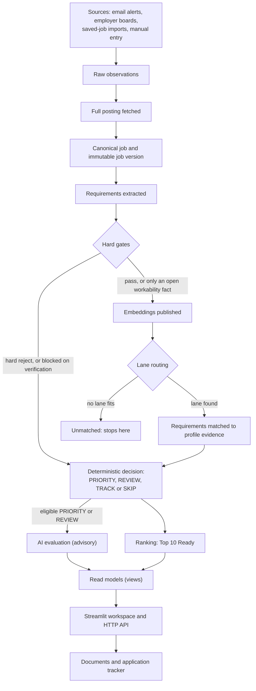
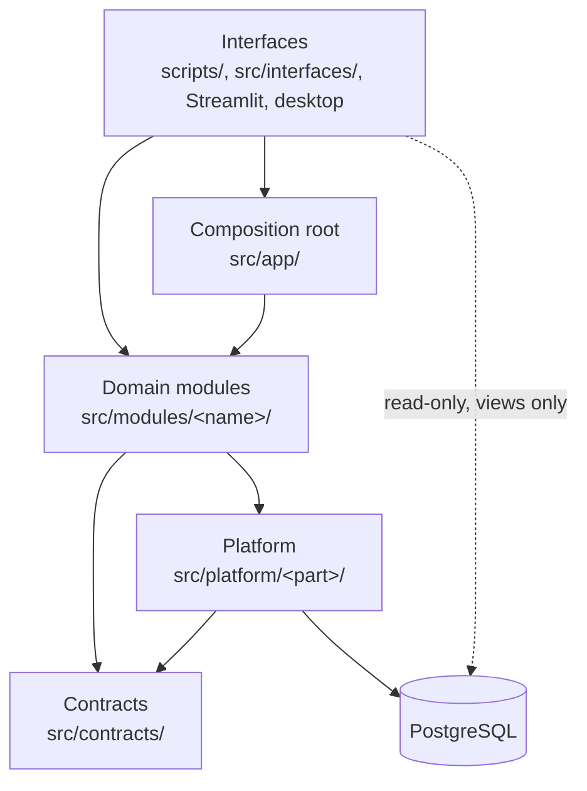

# Architecture

This document says how Job Decision Engine is structured, which part owns what, and what each part may touch. It has two halves:

- **Target architecture** (sections 2 to 8). Binding for every new file and every file that is moved. Most rules are checked by a test, so breaking one fails the build.
- **As built** (sections 9 to 15). The pipeline, states and entry points as they are, where the code lives today, the known violations, and the order in which they are removed.

The document is kept true by `src/tests/architecture/`. If a lane, pipeline stage, job state, table or rule changes in the code and not here, the test fails. See [Keeping this document true](#16-keeping-this-document-true).

Related documents: [`AGENTS.md`](../AGENTS.md) (operating contract and invariants), [`.agents/DATA-FLOW-CONTRACT.md`](../.agents/DATA-FLOW-CONTRACT.md) (what each boundary must prove), [`docs/data-contracts.md`](data-contracts.md) (runtime schemas and gate codes), [`docs/adr/`](adr/README.md) (decision records), [`docs/delivery-plan.md`](delivery-plan.md) (who is building what now), [`docs/architecture-review-2026-11-19.md`](architecture-review-2026-11-19.md) (the review behind this design).

## 1. What the system does

A posting is discovered, stored as evidence, checked by fixed rules, matched against the owner's profile, and given a decision. A model then adds an advisory evaluation to the short list. The owner reads the result, prepares documents and records the application.



Fixed rules decide. The model never sets a gate, a score or an outcome ([`AGENTS.md`](../AGENTS.md), invariant 11).

## 2. Principles

1. **One job per part.** Finding postings, storing them, extracting requirements, applying policy, matching, deciding, evaluating with a model, writing documents and tracking applications are separate modules.
2. **One owner per fact.** Every table has exactly one owning module. Only the owner writes it.
3. **One door per part.** Other code reaches a module through one public file and nothing else.
4. **Rules are pure.** A gate, a lane rule, a score and a decision are functions of their inputs. They read no database, no clock and no environment, so they run in a unit test with no setup.
5. **Results carry their inputs.** Every stored result names the job version, profile version and policy version it was computed from, so it can be recomputed and compared.
6. **The model is a tool, not an actor.** Model calls go through one gateway that knows nothing about jobs and cannot reach the database. Model output is validated, stored as advice, and never changes a decision.
7. **Failures are not rejections.** A timeout, a parser error or a provider error leaves a job waiting or in support, never rejected.
8. **Posting text is untrusted.** It is cleaned before a model sees it and escaped before a person sees it.

The design is a modular monolith: one program and one database, with firm walls inside. Separate services would add network calls and deployments that a single-owner tool does not need. The decision is recorded in [ADR 0001](adr/0001-modular-monolith-with-enforced-boundaries.md).

## 3. Layers



| Layer | Folder | Holds | May import |
|---|---|---|---|
| Interfaces | `scripts/`, `src/interfaces/`, `streamlit_*.py`, `desktop/` | Commands, scheduled entry points, HTTP routes, user interface. Parse input, call one module function, present the result. No rules and no SQL. | Composition root, module public files, platform public files, contracts |
| Composition root | `src/app/` | Wiring only: builds the database pool, the model gateway and the repositories, registers each module's task handlers with the queue. | Everything below |
| Domain modules | `src/modules/<name>/` | The rules and use cases of one job. | Earlier modules (public file only), platform public files, own repository, contracts |
| Platform | `src/platform/<part>/` | Technical services with no job rules. | Other platform parts (public file only), contracts |
| Contracts | `src/contracts/` | Shared types and runtime schemas. | Nothing |

Imports point downward only. Nothing imports upward, and nothing imports sideways except through a public file.

The platform cannot import a module, so the queue cannot name a stage. The composition root registers each module's handler against its task type. That keeps the queue generic and the stage logic inside its module.

## 4. Domain modules

Modules are listed in dependency order. A module may import only the modules above it in this table.

| # | Module | Its one job | Owns (main tables) | Code today |
|---|---|---|---|---|
| 1 | `sourcing` | Find postings and fetch their content | `raw_email_alerts`, `raw_job_observations`, `source_*`, `searchapi_*`, `employer_board_resolutions` | `src/ingestion/`, `src/services/gmail.ts`, `src/services/adapters/` |
| 2 | `catalog` | Hold the canonical job, its versions, confirmed facts and archive state | `canonical_jobs`, `job_versions`, `job_confirmed_facts`, `job_archive_*`, `verification_questions` | `src/pipeline/normalize.ts`, `src/services/jobArchive.ts`, `src/services/jobConfirmedFactService.ts` |
| 3 | `requirements` | Extract what a posting asks for, with quotes | `job_requirements`, `requirement_sets`, `requirement_extraction_runs`, `taxonomy_concepts` | `src/pipeline/requirementsExtractor.ts`, `src/requirements/` |
| 4 | `profile` | Hold the owner's facts, evidence, credentials and preferences | `profile_*`, `candidate_profiles`, `evidence_sources`, `workspace_user_preference_*` | `src/profile/` |
| 5 | `policy` | Apply the fixed rules: hard gates and lane routing | `gate_decisions`, `lane_decisions`, `lane_*`, `workspace_policy_snapshots` | `src/pipeline/hardGate.ts`, `src/services/criteria.ts`, `src/pipeline/laneRouter.ts`, `src/lanes/`, `src/policy/` |
| 6 | `matching` | Match requirements to profile evidence | `match_runs`, `requirement_evidence_matches`, `embedding_*`, `semantic_embeddings` | `src/pipeline/deterministicMatcher.ts`, `src/embeddings/` |
| 7 | `decision` | Turn gates, lane and match into an outcome and a rank | `deterministic_decisions`, `job_ranking_snapshots`, `job_rematch_waits`, `ranking_policies` | `src/pipeline/recommendationDecider.ts`, `src/services/applicationRankingMaterializer.ts` |
| 8 | `evaluation` | Queue and run the advisory model evaluation | `evaluation_queue`, `ai_evaluations`, `evaluation_attempts`, `evaluation_budget_deferrals` | `src/pipeline/explanationQueueEnqueuer.ts`, `scripts/evaluate_queue.ts`, part of `src/services/agent.ts` |
| 9 | `documents` | Generate CVs and cover letters from verified evidence | `document_*`, `manual_application_*`, `manual_evidence_pairings` | `src/documents/`, `src/services/renderers/` |
| 10 | `applications` | Record applications and their status history | `application_records`, `application_events`, `application_document_selections` | `src/api/v2/router.ts`, `src/documents/` |

The full table list is in [`src/architecture/table-ownership.json`](../src/architecture/table-ownership.json).

### Inside a module

```text
src/modules/<name>/
  index.ts     the public file: the only file other code may import
  domain/      pure rules and types: no database, model, clock or environment
  handlers/    use cases: load inputs through the repository, call domain code, save the result

src/platform/persistence/<name>/
  index.ts     the module's repository: every SQL statement that touches the module's tables
```

A handler receives what it needs as arguments: the repository, the model gateway, the clock, the configuration. It does not build them and does not read `process.env`. That is what lets the same handler run in production, in a replay against a database copy, and in a test.

A public file exports functions and types. It does not export the repository, a database client or a SQL string.

## 5. Platform parts

| Part | Folder | Does | Must never |
|---|---|---|---|
| `config` | `src/platform/config/` | One typed loader for settings, model IDs and prices; validates at start | Be bypassed with `process.env` in a module |
| `observability` | `src/platform/observability/` | Structured logs, run reports, counters | Log posting text, profile data or connection strings |
| `security` | `src/platform/security/` | Workspace identity, text cleaning, bounded and public-safe errors | Hold job rules |
| `persistence` | `src/platform/persistence/` | The database pool, transactions, and one repository folder per owner | Export a general query function to modules |
| `llm` | `src/platform/llm/` | The model gateway: typed request in, validated result and usage out; retries, fallback, budgets | Import the database driver, a repository or a module |
| `prompts` | `src/platform/prompts/` | Prompts with an id, a version and an output schema | Be assembled inline in a module |
| `orchestration` | `src/platform/orchestration/` | The task queue: claim, lease, retry, dead-letter | Know what a stage means or read a module's tables |

The owner of platform tables is the part itself: `orchestration` owns `pipeline_*`, `llm` owns `model_route*`, `config` owns `config_*`, `security` owns `workspaces` and the workspace user tables.

## 6. Boundary rules

Each rule has an id. The check reports a violation as `RULE|subject|detail`.

### Rules for the target layout

These apply to every file under `src/modules/`, `src/platform/`, `src/interfaces/` and `src/app/`. There is no baseline for them: a violation always fails.

| Rule | Meaning | Why |
|---|---|---|
| B1 | Imports point downward: interfaces, modules, platform, contracts. | A lower layer that knows an upper one cannot be reused or tested alone. |
| B2 | Another module or platform part is reached only through its `index.ts`. | A part can change inside without breaking its users. |
| B3 | A module imports only modules that come before it in the order of section 4. | No cycles. Evaluation can read a decision; a decision can never depend on an evaluation. |
| B4 | Code in a module's `domain/` folder is pure: it imports no database, model, network or file package, and reads neither `process.env` nor the clock. | Rules can be tested and replayed exactly. |
| B5 | The model gateway never imports the database driver or persistence. | A model call cannot read or change stored data. |
| B6 | Only `src/platform/persistence/` imports the database driver. | There is one place to look for every query. |
| B7 | A repository folder is named after its owner and is imported only by that owner and by the composition root. | A module cannot use another module's queries. |
| B8 | SQL lives in persistence. A repository writes only its owner's tables. A module's repository reads its own tables, platform tables, tables of earlier modules, and views. A platform repository reads platform tables only. Nothing reads legacy tables. | One writer per fact, and data flows in one direction. |

Cross-module joins belong in a database view, not in code. Views named `v_*` are the read models that interfaces use.

### Rules that freeze the legacy layout

The code that exists today breaks these rules in known places. Those places are recorded in [`src/architecture/boundary-baseline.json`](../src/architecture/boundary-baseline.json). Anything not recorded fails the build, so the debt can shrink but cannot grow.

| Rule | Meaning |
|---|---|
| F1 | No new import cycle between files. |
| F2 | No new pair of legacy areas that import each other. |
| F3 | No new database access from `scripts/` or `src/api/`. A new command calls a module function. |
| F4 | No new importer of `src/services/agent.ts` or `src/db/db.ts`. |
| F5 | No new file in `src/services/`. New code goes into a module or a platform part. |
| F6 | No new writer of a job status column on `canonical_jobs` (section 7). |
| F7 | No new legacy area writes a table. An area is `scripts` or one folder under `src/`. |
| F8 | The Streamlit interface reads no new table and writes none. It reads views. |
| F9 | No new upward import. `src/db/` imports no area above it. `src/pipeline/` imports no queue, API, read-model or desktop code. |
| F10 | `src/services/modelCallResilience.ts`, which holds retry, timeout and fallback for model calls, imports no database, workspace, pipeline, queue, read-model or API code. |
| F11 | Code under `src/` never imports a script. |

`src/services/agent.ts` also has a line limit. It may shrink and may not grow.

### How the check works

- There is one check and one baseline. The rules are in [`src/architecture/boundaries.ts`](../src/architecture/boundaries.ts). The test is [`src/tests/architecture/boundaries.test.ts`](../src/tests/architecture/boundaries.test.ts). It runs with `npm test`, so it runs in CI on every pull request.
- A new violation fails with its key. Fix the code. Do not edit the baseline to make the test pass.
- When a recorded violation is fixed, the test asks for the baseline to be pruned: `ARCH_BASELINE=prune npx vitest run src/tests/architecture/boundaries.test.ts`. Pruning only removes entries.
- Adding a baseline entry is a hand edit and an exception. Each added entry and its reason go at the top of the pull request description, so the owner sees it before merging.
- Until the persistence layer exists (phase 5), a new command that must query the database is such an exception. Prefer extending an existing command.

### What the check cannot see

- SQL whose table name is built at run time, or written with lower-case keywords. Every statement in the repository uses upper-case keywords and literal table names; keep it so.
- SQL inside migrations: views, functions and triggers. Migrations are reviewed by the `database-versioning-engineer` and `data-contract-checker` roles.
- Read direction in legacy code. Only writes are frozen there.
- Hidden state inside a pure function, such as a module-level cache. Review covers this.
- Python other than `streamlit_*.py`.

## 7. Data ownership

- Every table has one owner in [`src/architecture/table-ownership.json`](../src/architecture/table-ownership.json). A migration that creates a table must add it there, or the test fails.
- Owners are the ten modules, the platform parts `orchestration`, `llm`, `config` and `security`, and `legacy`.
- `legacy` tables (`jobs`, `raw_jobs`, `raw_companies`, `companies`, `interactions_log` and the unused audit and cutover tables) are scheduled for retirement. New code neither reads nor writes them.
- Only the owner writes a table. Another module that needs a change calls the owner's public function.
- A user interface never writes a table. Streamlit reads views only; every change it makes goes through the HTTP API, which calls a module.

### Job status columns

`canonical_jobs` carries copies of facts that belong to other modules: `processing_state`, `processing_status`, `gate_decision`, `primary_lane`, `routing_disposition`, `profile_match_status`, `recommendation_outcome` and `recommendation_eligibility`. Today several files update each one, which is how a rejected job could keep an old recommendation.

Target:

1. The module that owns the fact saves it in its own table: `policy` in `gate_decisions` and `lane_decisions`, `matching` in `match_runs`, `decision` in `deterministic_decisions`, `evaluation` in `ai_evaluations`.
2. It then calls one `catalog` function that updates the copy. Each column has one update statement, in the `catalog` repository.
3. Later the copies are removed and job status becomes a view over the result tables.

Until then rule F6 lists every file that writes each column, and no file may be added.

### The concept graph

Matching needs a shared vocabulary: a requirement is about a concept, and a profile fact is evidence for a concept. The tables `taxonomy_concepts` and `profile_fact_concepts` exist for this, but no code fills `taxonomy_concepts`, requirements have no concept link, and `evidence_edges` is unused. Matching therefore compares sentences by embedding similarity. Building the concept links is phase 6 of the migration (section 15). It stays inside PostgreSQL; a separate graph database is not planned.

## 8. Model calls

| Rule | Target | Today |
|---|---|---|
| One gateway | Every model call goes through `src/platform/llm/` with a typed request and a typed result | Calls are made from `src/services/agent.ts`, which also holds prompts, parsing and database writes |
| No database in the gateway | B5 | The audited call path in `src/services/agent.ts` takes a database client |
| Model IDs in one place | `src/platform/config/` only; checked against the providers with `npm run models:check` | The evaluation default is in `src/services/modelDefaults.ts`. Other defaults are still spread across `src/services/agent.ts`, `src/services/openAiModelRoles.ts`, scripts and environment variables |
| Versioned prompts | Each stored output records prompt id, prompt version and model | Prompts are built inline. Only the quoted-requirement prompt records a hash |
| Advice only | An evaluation is stored in `ai_evaluations` and never changes a gate, a score or an outcome | Holds. The legacy evaluator (`runAgent`, its database tool, `eval:golden` and `eval:run`) is deleted |
| Cleaned input | Posting text is cleaned and delimited before any model sees it | The posting is placed in the same message as the instructions, with no cleaning step |
| Bounded spend | Lane budgets and deferrals are recorded per run | In place: `ai_evaluation_budget_runs`, `evaluation_budget_deferrals` |

## 9. Pipeline stages

A stage is a task in `pipeline_tasks`. The worker is `scripts/process_pipeline_tasks.ts`, which runs `src/tasks/stageTaskWorker.ts`. Task types are defined there as `PIPELINE_STAGE_TASK_TYPES`.

A `ROUTE_LANE` or `PUBLISH_EMBEDDING` task claimed for a job version whose canonical job is `HARD_REJECTED`, or `NEEDS_VERIFICATION` with a non-routable gate result (`isRoutableWorkabilityVerification`), completes with `repair_action = SUPERSEDED_BY_GATE_OUTCOME`. It is a recorded no-op, never a failure or dead letter, and it changes no job state or gate evidence. `PUBLISH_EMBEDDING` queues no `ROUTE_LANE` successor for such a job. A later enqueue of the same task identity reopens a superseded task. Every `enforcePipelineWorkerExitPolicy` failure message starts with `[rule=NAME]`, naming the rule that fired.

| # | Task type | What it does | Code today | Target module |
|---|---|---|---|---|
| 1 | `FETCH_JOB_CONTENT` | Fetches the full posting for a discovered link | `src/ingestion/jobContentFetcher.ts` | `sourcing` |
| 2 | `NORMALIZE_OBSERVATION` | Creates or updates the canonical job and a new immutable job version | `src/pipeline/normalize.ts` | `catalog` |
| 3 | `EXTRACT_DETERMINISTIC_REQUIREMENTS` | Extracts requirements from the posting text by rule | `src/pipeline/requirementsExtractor.ts` | `requirements` |
| 4 | `APPLY_HARD_GATES` | Checks location, work mode, employment type, pay and title rules | `src/pipeline/hardGate.ts`, `src/services/criteria.ts` | `policy` |
| 5 | `EXTRACT_QUOTED_REQUIREMENTS` | Optional model-assisted extraction with quotes. A failure here never blocks the job | `src/pipeline/requirementsExtractor.ts` | `requirements` |
| 6 | `PUBLISH_EMBEDDING` | Publishes the embeddings that routing and matching compare: job, requirements, profile facts, lane prototypes | `src/embeddings/batchCoordinator.ts` | `matching` |
| 7 | `ROUTE_LANE` | Chooses the lane, or records that none fits | `src/pipeline/laneRouter.ts` | `policy` |
| 8 | `MATCH_PROFILE_EVIDENCE` | Matches each requirement to profile evidence | `src/pipeline/deterministicMatcher.ts` | `matching` |
| 9 | `DECIDE_RECOMMENDATION` | Computes eligibility and the outcome | `src/pipeline/recommendationDecider.ts` | `decision` |
| 10 | `ENQUEUE_EXPLANATION` | Puts an eligible job on the evaluation queue within the lane budget | `src/pipeline/explanationQueueEnqueuer.ts` | `evaluation` |
| 11 | `RECHECK_AVAILABILITY` | Re-reads a posting whose 7-day availability window ran out: open or closed, work mode, hiring territory | `src/tasks/availabilityRecheck.ts` | `catalog` |

Order of work:

- Stages 1 to 4 run in sequence for every job.
- A job that passes the gates continues to 6, 7, 8 and 9. So does a job whose only open items are workability facts that can be checked later, such as an unknown work mode (`src/pipeline/verificationRouting.ts`). It is matched and triaged while the question is open.
- A hard-rejected job, and any other job that needs verification, goes straight to stage 9, so its decision is recorded.
- If lane routing finds no lane, the job becomes `UNMATCHED` and stops. If routing could not run for a technical reason, the job becomes `ROUTING_DEFERRED` and goes to stage 9.
- Stage 10 follows stage 9 only when eligibility is `ELIGIBLE` and the outcome is `PRIORITY` or `REVIEW`, and only when the owner's AI switch allows it (below).

### The owner's AI switch

Explanation and evaluation work fails closed. It is queued and run only when all three are set (`src/platform/config/aiWorkConfig.ts`), with no defaults:

| Setting | Value |
|---|---|
| `AI_EVALUATION_ENABLED` | exactly `true` |
| `AI_EVALUATION_SCORE_CUTOFF` | the cut-off the owner approved, a decimal from 0 up to, not including, 1 |
| `AI_EVALUATION_SCORE_POLICY` | the score scale it was approved on, as stored in `canonical_jobs.recommendation_score_policy` (`<match policy>\|<role-shape policy>`) |

A job qualifies when its stored ranking score (`canonical_jobs.recommendation_requirement_score`) is strictly above the cut-off and its score policy equals the approved one. A job with no score, or scored under another policy, does not qualify. The rule is in `src/modules/evaluation/`.

A value that is set but cannot be read holds the AI work and fails the run: the pipeline worker finishes its other stages and exits non-zero; the evaluation worker, the enqueuer, the scoped pilot and the model comparison stop at once.

| Path | Switch closed | Switch open, job does not qualify |
|---|---|---|
| Creating an `ENQUEUE_EXPLANATION` task (successor of stage 9, successor of a lane re-route, recoverable seed) | Not created | Not created |
| An `ENQUEUE_EXPLANATION` task already waiting | Not claimed and not reconciled; stays `PENDING`, `RETRY_WAIT`, or `RUNNING` with its expired lease, unchanged | `BLOCKED_DEPENDENCY` on `AI_SCORE_CUTOFF:<job version id>` when claimed |
| `runExplanationQueueEnqueuer` (any caller, including the re-match script) | Reads and writes nothing | No queue row, no deferral, no state change |
| `scripts/evaluate_queue.ts` | Evaluates no queue item, makes no model call; only supersedes unstarted rows of leads | Makes no model call for the row; the row stays queued |
| `scripts/compare_evaluation_models.ts --run` | Refuses and exits non-zero | The job is left out of the sample |

Holding is not a rejection: no job state, decision or deferral row changes. The one queue change made while held is for a lead (below), whose unstarted row is not waiting AI work. When the switch opens, waiting tasks are claimed and the recoverable seed creates the missing ones. A blocked task is reopened only when the same task identity is enqueued again; otherwise a new task is created and the blocked row stays, still counted.

The worker summary and the evaluation worker report `aiWork`: the switch, waiting tasks (and how many of them have an expired lease), tasks blocked on the cut-off, unfinished queue rows (and, while open, how many do not qualify) and jobs without an evaluation. While the switch is closed, the pending and retry SLOs of the pipeline worker and of the scoped pilot leave held tasks out; queue health still counts them. The scoped pilot report names the hold in `aiHold`. While the switch is closed, a waiting task also does not run its lane, profile or decision currency repairs; the lane re-route and profile re-match seeds still run.

Task seeds (`seedRecoverablePipelineTasks`, `src/tasks/stageTaskWorker.ts`):

- Every capped seed selects live jobs only. `applyLiveJobScope` (`src/tasks/seedQueryScope.ts`) puts `archived_at IS NULL` and, unless fixtures are included, `is_test_fixture IS NOT TRUE` inside the query, before its `LIMIT`. Only the observation seed (`NORMALIZE_OBSERVATION`) has no canonical job and is exempt. A new seed gets the scope without writing it, and a query with no `WHERE c.workspace_id = $1` anchor throws.
- A job the enqueue still refuses as archived is counted as `skippedArchived`, never as `existing`.
- Every seed step runs in every pass. `PIPELINE_TASK_WORKER_SEED_BUDGET_MS` is reported (`timeBudgetExceeded`) and skips no step: each stage's share is guaranteed because a step makes a fixed number of database round trips, whatever the number of candidates (read, target context, stored task identities, one insert, and the reopen updates). The identity reads and the insert are in `src/platform/persistence/orchestration/`. A candidate whose task is already stored under the same identity takes no slot of `PIPELINE_TASK_WORKER_MAX_SEED_PER_TYPE`; when the first read is full and slots stay free, one wider read (8 x the cap, at most 2000 rows) fills them (`seedPastQueuedWork`). Blocked tasks, tasks superseded by a gate outcome, AI enqueue tasks skipped because the job was a lead and unstamped decider reassessments are reopened as before and take a slot; a `DEAD_LETTER` task is never re-queued by a seed. The batched path refuses a job lead for the AI enqueue, as the one-task enqueue does. The cap is per stage and per pass, so re-scoring N jobs takes at least ceil(N / cap) passes.
- A `DECIDE_RECOMMENDATION` task for a `HARD_REJECTED` or `UNMATCHED` job with a recorded outcome completes without a decider run only when a decision row already exists for that version and the task is not a decider-version reassessment (`DECIDER_VERSION:` reason). A reassessment runs the decider in `preserveStoredOutcome` mode: the decision is stamped only if it agrees with the stored outcome and eligibility, the job's recommendation columns never change, and a disagreement closes the task with `repair_action = OUTCOME_CONFLICT_ON_TERMINAL_JOB` without writing (no retry, no `PROCESSING_ERROR`); the failing post-phase zero check `terminal_outcome_conflict` keeps it visible (cleared by a decider version bump or `reopenOutcomeConflictTasks` after a correction; not run in the pre-drain phase so it never blocks the drain). The DECIDE seed selects only jobs the decider can process (complete description with source content, a state past routing, no closed conflict). A job without complete content waits in the awaiting-content read model and is not decided.
- The stale-stage zero check (`stage_result_older_than_rule_version`) covers the extractor, matcher, lane router, decider and gate stages. The decider stage equals what the DECIDE seed reaches and the handler can stamp; stale decisions outside it are reported as `reported_counts` by `reconcile_pipeline.ts`, never as errors.

- A re-run never clears a result. A recompute without a score carries the stored one. A job without a current match also keeps its stored outcome, lowered only by facts that do not depend on the score (the rule is `keepStoredOutcome` in `src/modules/decision/`); such a result never goes to AI. A current match that compared nothing is a real result. A re-gate and an incomplete re-match keep the stored scores and decision. A real hard reject by the gate does clear the stored recommendation, score and coverage included; pay below the floor ends at Skip. A restore from the archive never clears or replaces a result: every restore queues a forced re-gate and the decision, and until a match completes after it the job keeps its old result, is marked as waiting and is not sent to AI. Only the pointer to the earlier decision is cleared. The view `v_job_awaiting_rematch` (migration 124) marks waiting jobs, restored ones included; `job_rematch_waits` records when each began to wait (set once, cleared on leaving). The zero check `awaiting_rematch_over_limit` flags any job that has waited, from that start, longer than `AWAITING_REMATCH_LIMIT_DAYS` (7, `src/modules/decision/domain/keptOutcome.ts`).
- A stage task completes successfully only when its result exists or it records a designed no-op in `repair_action` (`src/tasks/designedNoOps.ts`): `DECISION_NOT_STAMPABLE:<reason>` for DECIDE (reasons `PRE_ROUTING_STATE`, `TERMINAL_HAS_DECISION`, `AWAITING_CONTENT_NOT_DECIDABLE`, `NO_CURRENT_MATCH_RUN`) and `MATCH_NOT_APPLICABLE:<state>` for MATCH. A DECIDE task for a terminal job whose version the decider cannot select closes with `DECISION_NOT_STAMPABLE:AWAITING_CONTENT_NOT_DECIDABLE` before the content gate. A decider run that wrote no decision for a decidable job fails the task. An EXTRACT task forces a re-extraction of a version-stale active set and completes only when the current `DETERMINISTIC_EXTRACTOR_VERSION` made it. DECIDE also closes as `DECISION_NOT_STAMPABLE:JOB_REMOVED` / `JOB_ARCHIVED` for a removed or archived job, and a re-match the matcher no longer selects closes as `MATCH_NOT_APPLICABLE:UNMATCHED_NOT_SELECTABLE`. `ROUTE_LANE` is unchanged: its post-router returns happen only in a state the router itself produced, and the lane-router stale-stage arm already requires a current-version decision.
- `enqueuePipelineTask` reopens a `COMPLETED` DECIDE task whose `reassessment_reason` starts `DECIDER_VERSION:` when its version has no decision stamped under the current decider version and `deciderReachableSql` (`src/tasks/seedQueryScope.ts`, shared with the seed handler and the `decider` stale-stage arm) accepts the job; an `OUTCOME_CONFLICT_ON_TERMINAL_JOB` closure under the current decider version stays closed.
- The profile re-match seed (`supersededProfileMatchSql`, shared with the `matcher` stale-stage arm) also reopens a live `UNMATCHED` job with `routing_disposition = ROUTED` whose latest match run was made under another matcher policy version (a version change reopens every stage). The re-match never changes gate, lane or routing disposition; a job still failing a mandatory qualification under the current matcher stays `UNMATCHED`, and a `POLICY_NO_MATCH` job stays with the lane router.

After the stages:

| Step | Code today | Target module |
|---|---|---|
| Advisory evaluation of queued jobs, behind the owner's AI switch | `scripts/evaluate_queue.ts` | `evaluation` |
| Ranking of Apply Now jobs into Top 10 Ready | `scripts/materialize_application_rankings.ts`, `src/services/applicationRankingMaterializer.ts` | `decision` |
| Archiving of rejected and aged jobs | `scripts/archive_jobs.ts`, `src/services/jobArchive.ts` | `catalog` |

### Ranking composite (policy version 5.5.0, migration 122)

The overall rank is a weighted average of four deterministic terms, renormalised over the terms that are available. The AI-derived terms are labels and never enter the sort (AGENTS.md invariant 11).

| Term | Weight | Share of the composite |
|---|---|---|
| `requirementFit` | 37.5 | 51.7% |
| `requirementCoverage` | 15 | 20.7% |
| `evidenceCompleteness` | 10 | 13.8% |
| `laneConfidence` | 10 | 13.8% |

Worked example: fit 80, coverage 60, evidence 70, lane 100 gives (80 x 37.5 + 60 x 15 + 70 x 10 + 100 x 10) / 72.5 = 77.241. A Low lane confidence (30) instead of High (100) costs 70 x 10 / 72.5 = 9.66 composite points.

- Removed from the composite: autonomy, politics risk, sensory workload risk, culture priority fit, and the always-empty strategic value. Their weights are stored as 0 in `ranking_policies`; the materializer rejects a policy that gives any of them a positive weight.
- The AI values stay stored on `job_ranking_snapshots` (`autonomy_score`, `politics_risk_score`, `sensory_workload_risk_score`, `focus_protection_score`, `culture_priority_score`, and the quotes in `component_provenance.culture_evidence`). They are exposed read-only as `ai_label_*` columns on the Stage 3 views. Configured culture priorities only change the label `culture_priority_score`; they no longer move any weight.
- Top 10 no longer requires a current AI evaluation. A job without one is ranked from its deterministic terms, its snapshot has `ai_evaluation_id` NULL, and the Stage 3 views show `ai_notes_pending = TRUE`.
- Apply Now priority is unchanged: 0.75 x composite + 0.125 x freshness + 0.125 x remote freedom.
- Transient states, by design: (1) until the first materializer run after migration 122 the Top 10 is empty, because only snapshots of the latest policy version are read; (2) when an evaluation completes, the job keeps its snapshot without an evaluation (`ai_notes_pending = TRUE`) until the next materializer run writes the snapshot that carries it, and never has zero Top 10 rows in between (the views prefer a snapshot with a current evaluation and fall back to the one without).
- A latest policy that gives an AI term a weight is refused for that workspace: the materializer returns `policyError`, writes nothing, and the script exits non-zero.
- Version rule: a snapshot is keyed by `ranking_policy_version`, and the read models join the latest policy version, so a new `ranking_policies` row makes the materializer write a new snapshot for every eligible job (no AI call). Until it runs, the Top 10 is empty. The previous version's snapshots stay as history. `src/pipeline/rankingPolicyComparison.ts` compares two policy versions read-only (Top 10 side by side, rated rows marked, lane confidence effect).

## 10. Job states, decisions and status

### Job states

Stored in `canonical_jobs.processing_state` (`processing_status` holds the same value). The list is the enum in `src/contracts/index.ts`. There is no database constraint on the column.

| State | Meaning | Set by |
|---|---|---|
| `RAW_STAGED` | Canonical job created, not yet gated | Normalize |
| `PREQUALIFIED` | Passed the hard gates | Hard gates |
| `NEEDS_VERIFICATION` | A workability fact is unknown; the owner is asked | Hard gates |
| `HARD_REJECTED` | Conflicts with a hard rule, with stored reason codes | Hard gates |
| `LANE_ROUTED` | A lane was chosen | Lane routing |
| `ROUTING_DEFERRED` | Routing could not run for a technical reason | Lane routing |
| `UNMATCHED` | No lane fits, or a mandatory qualification is missing | Lane routing, matching |
| `MATCHED` | Requirements matched to profile evidence | Matching |
| `QUEUED_FOR_AI` | On the evaluation queue | Enqueue |
| `AI_EVALUATED` | Advisory evaluation stored | Evaluation worker |
| `NEEDS_MANUAL_REVIEW` | Evaluation retries exhausted | Evaluation worker |
| `PROCESSING_ERROR` | A stage failed and needs support | Stage worker |
| `MANUALLY_REMOVED` | Removed or dismissed by the owner | HTTP API |
| `EVALUATING`, `RETRY_WAIT` | In the enum; in practice these are statuses of a row in `evaluation_queue`, not of the job | Not set on jobs |
| `DEFERRED_BUDGET` | In the enum; since migration 060 a budget deferral is a row in `evaluation_budget_deferrals` and the job keeps its state | Not set |
| `SEMANTIC_SHORTLISTED`, `EVALUATED`, `REJECTED_AFTER_EVALUATION` | Older values kept for historical rows | Not set |

[`AGENTS.md`](../AGENTS.md) describes the flow with conceptual names. They map to stored values as follows: DISCOVERED is a row in `raw_job_observations`; NORMALIZED is `RAW_STAGED`; GATE_PASSED is `PREQUALIFIED`; EVALUATED is `AI_EVALUATED`.

### Decision values

| Fact | Values | Owner |
|---|---|---|
| Gate result | `PASS`, `NEEDS_VERIFICATION`, `HARD_REJECT` | `policy` |
| Eligibility | `ELIGIBLE`, `VERIFY`, `INELIGIBLE` | `decision` |
| Outcome | `PRIORITY`, `REVIEW`, `TRACK`, `SKIP` | `decision` |

### Status buckets

The owner sees one bucket per job. The view `v_job_status_buckets_scoped` computes it; the list is `JobStatusBucketSchema` in `src/contracts/jobStatus.ts`.

`APPLY_NOW`, `REVIEW_AWAITING_AI`, `REVIEW_EVALUATED_NOT_READY`, `TRACK`, `NEEDS_VERIFICATION`, `PROCESSING`, `SKIP`, `TECHNICAL_ERROR`, `REJECTED`, `UNMATCHED`, `REMOVED`.

### Availability

Whether a posting is currently open is decided in one place: `assessAvailability` in `src/decision/availability.ts`. The view `v_job_availability_current` states the same rule in SQL, and a parity test fails if the two differ. Every list reads that view's `availability_current` field. No list or script works it out for itself.

| Moment | What happens |
|---|---|
| Seen in the employer's feed, or its page shows the posting | Open, valid for 7 days. Each sighting extends it |
| Day 7 passes with no sighting | Hidden from every list and counted as "awaiting re-check". A re-check task is queued |
| Re-check finds the posting | Open for 7 more days |
| Re-check gets a clear closure: the page says not found or no longer accepting, or the feed was read successfully and the job is absent twice in a row | Archived the same day as closed |
| Re-check cannot tell: timeout, server error, paywall, login | Retried up to 3 times over 3 days, then archived as not confirmable |

A manual same-day check of a chosen job list (`scripts/check_availability_now.ts`, replay copies only; plan mode unless `--apply`) reads each posting link once, never a LinkedIn, aggregator or job-board link, and stores availability evidence through the same re-check. It queues nothing, changes no job fact, never archives, and its reads count for neither the retries nor the archive health check. An apply is bound to the confirmed plan. It can take the page reader's verdict back to cannot-tell, never the other way; the automatic re-check does not use that rule.

Posting age decides nothing about whether a job is open (owner decision 2026-11-27). The gate never rejects or holds a job for its age, whatever the freshness preference says, and the `FRESHNESS` readiness check is information only: importance `PREFERRED`, never blocking, holding or expiring readiness. Age still lowers the ranking freshness score, and the age archive rule (three calendar months, `docs/job-archiving.md`) is a lifecycle rule.

An expired window is "unknown", never "closed". Saved, applied and held jobs are never archived automatically, and an archived job that reappears is restored. The rule and the list filtering are built; the automatic re-check and archive are in progress.

### Unknown facts

A job with an unknown workability fact (work mode, hiring territory, office days, travel) is not stopped and not rejected.

1. The fact is resolved automatically where the data exists: structured feed fields, or the posting text re-read by the availability re-check.
2. If it stays unknown, the job continues to matching and decision with the question left open.
3. A question is raised to the owner only when the job ranks in the top 20.
4. A job that is unresolved for 28 days and never reaches the top 20 is archived as not confirmable. This is reversible and is not a rejection.

### Awaiting content

A live job that is not hard-rejected and whose posting text has not reached the completeness rule (`description_quality_status` is not `COMPLETE`, or the only evidence is a bare Gmail alert) has no gate result, lane or recommendation in any list. It waits as "awaiting content" until its posting is fetched. The view `v_job_content_state` states the rule once; `v_canonical_shortlist_scoped` and everything built on it exclude waiting jobs, and `v_job_awaiting_content_scoped` lists them with the state of their fetch task. Stored decisions are kept, so a job returns to the lists when its content is complete. `scripts/check_integrity.ts` fails when a waiting job still carries a gate decision, lane or recommendation.

### Leads

A job known only from job boards or aggregators is a **lead**. It stays stored with its observations, decisions and history, is never rejected or deleted for being a lead, and is left out of every ranked list, the shortlist, Review, Track, Apply Now, Top 10, the AI queue and the review draw.

The view `v_job_lead_state` (migration 123) is the one definition; no list, script or module keeps its own. `is_lead` is true when all of these hold:

1. Some sighting of the job is on a job-board or aggregator host, or comes from a job-board source. A sighting is the job's link, or the source link, apply link or source name of any observation of any version (and of the observation it was derived from).
2. No observation is the employer's own posting: an employer source (Greenhouse, Lever, Ashby, Workable, SmartRecruiters, Workday, employer website) whose source link is not on a job board or aggregator.
3. No observation was provided by the owner: LinkedIn or MyCareersFuture saved export, manual import, pasted description.
4. No sighting is on a host or source marked `NOT_LEAD`: LinkedIn (owner decision) and, while the owner has not decided, MyCareersFuture.

Every host and source entry is a row of `v_job_lead_rules`; changing the MyCareersFuture row from `NOT_LEAD` to `AGGREGATOR` makes those jobs leads. A job stops being a lead as soon as the employer's or the owner's posting is observed, and returns to the lists with its stored artifacts.

`v_canonical_shortlist_scoped` excludes leads, so every view built on it does. The AI enqueue, the evaluation queue selection and the review draw ask the `catalog` module (`listLeadJobIds`, `isLeadJobVersion`); unstarted queue rows of a lead are marked `SUPERSEDED`. The blind review draw counts the leads it leaves out under their own reason, `LEAD_JOB_BOARD_OR_AGGREGATOR`; its LinkedIn exclusion is a separate rule. Hard gates, lanes, matching, decisions and content fetches run for leads as for any job. The must-be-zero check `lead_in_list_or_queue` fails a post-drain reconcile when a lead is in a list or the AI queue.

The superseding does not wait for the owner's AI switch: the pipeline worker (any run that includes `ENQUEUE_EXPLANATION`) and `scripts/evaluate_queue.ts` do it while the switch is closed too, so a held queue never keeps a lead. The `aiWork` counts leave leads out. A waiting enqueue task of a lead completes without queueing and is never blocked on the cut-off. An application handoff, a document draft preflight, a document currentness check and the scoped pilot's `aiHold` name a lead as `JOB_IS_LEAD`.

A job already queued when it becomes a lead keeps its state, normally `QUEUED_FOR_AI`; no job status is rewritten and its superseded row stays as history. When it stops being a lead, the recoverable seed reads that row and creates a new enqueue task (`lead_superseded_queue_id` in the task context), so the completed earlier task does not hold it back; the switch, cut-off and lane budget apply as for any job. The integrity check for nonterminal jobs without work does not count such a job while it is a lead, while the switch or cut-off admits no AI work for it, or after the AI budget deferred it; otherwise it counts it until the seed has queued it. An enqueue task that finds its job has become a lead completes as `SKIPPED_JOB_IS_LEAD` without queueing, and the same task identity is reopened when it is enqueued again. The post-drain must-be-zero check `returned_lead_not_queued` reports an eligible job with an AI outcome that is no longer a lead and was left unqueued: while the switch admits it, or, whatever the switch says, when its new task has completed without queueing it.

A live job is therefore in exactly one of: a status bucket, awaiting content, or `v_job_leads_scoped` (live, content-complete, not hard-rejected or removed leads). A hard-rejected or removed lead stays in its audit bucket. A lead the owner saved to the application tracker stays there, marked as a lead.

Until migration 123 is applied the code treats no job as a lead, says so in the log, and the check reports that it was not evaluated (`scripts/check_integrity.ts` prints `NOT EVALUATED`, not `OK`).

### What blocks a job

A mandatory requirement blocks a job only when it is a degree or credential that the matcher compared with the profile and found short, and the posting does not accept an equivalent. A free-text requirement with no supporting evidence does not block: it lowers coverage. Job duties, and skills in a posting with no section headings, are not mandatory unless the item itself says so.

Task status (pending, retrying, failed) and job status (rejected, review, priority) are different things. Task status belongs to `orchestration`. A failed task never changes a job's decision.

## 11. Lanes

Lanes are defined in `config/lanes/registry.yml`, one file per lane in `config/lanes/`.

- `CORE_AI_DATA`
- `LEGAL_REGTECH`
- `HEALTH_BIO_PHARMA`
- `INVESTMENT_MARKETS_FINTECH`
- `SOCIAL_IMPACT_MULTILATERAL`
- `UNIVERSITY_AI_RESEARCH`
- `TECHNICAL_PRODUCT_TRANSFORMATION`
- `INVESTIGATIONS_ENFORCEMENT`

## 12. Identity, versions and sources

Every observation keeps source identity and raw payload evidence. Canonical jobs may have multiple immutable `job_versions`. Gates, queue rows, evaluations, shortlist rows, and documents are pinned to `job_version_id`.

To ask whether two records are the same posting, compare employer and location through `normalizeJobIdentity` (`src/modules/catalog/`): legal suffixes and the ways of writing Singapore do not matter. It changes no stored key and merges no record. The blind review draw uses it; the stored dedupe keys and the lists do not yet.

Public connectors are described by versioned source plugin manifests under `config/source-plugins/`. Each raw observation can link to the active immutable source plugin revision, enabling later compliance and audit reporting. See [`docs/source-adapters.md`](source-adapters.md).

## 13. Entry points

### Scheduled workflows

All four stop when the repository variable `WORKFLOW_KILL_SWITCH` is `true`.

| Workflow | When (UTC) | Runs |
|---|---|---|
| `.github/workflows/ingest.yml` | Daily, 02:00 | Email and source ingestion, then the pipeline worker and the evaluation worker |
| `.github/workflows/process_backlog.yml` | Hourly, minute 35 | Reconciliation, the pipeline worker, ranking |
| `.github/workflows/queue_worker.yml` | Hourly, minute 0 | The evaluation worker, ranking |
| `.github/workflows/daily-job-archiving.yml` | Daily, 19:15 | Archiving ([`docs/job-archiving.md`](job-archiving.md)) |

### Interfaces

| Interface | Code today | Reads | Writes |
|---|---|---|---|
| Streamlit workspace | `streamlit_app.py` and `streamlit_*.py` | Views | Nothing; changes go through the HTTP API |
| HTTP API v2 | `src/api/v2/`, started by `npm run workspace` | Through modules (target) | Through modules (target) |
| Commands | `scripts/` | Through modules (target) | Through modules (target) |
| Desktop app | `desktop/`, `src/desktop/` | The HTTP API | The HTTP API |
| MCP server and SDK | `src/mcp/`, `src/sdk/` | The HTTP API | The HTTP API |

## 14. As built

Most of the code predates the target layout. `src/platform/` holds the `config` and `llm` parts and the `catalog`, `decision` and `evaluation` repositories; `src/modules/evaluation/` holds the owner's AI switch, the first domain module, `src/modules/catalog/` holds the lead questions and the employer and location comparison used to recognise one posting under two records, and `src/modules/decision/` holds the rule for the stored result of a job that waits for a re-match and the record of when the wait began. Nothing lives under `src/interfaces/` or `src/app/` yet.

| Area today | Holds | Goes to |
|---|---|---|
| `src/services/` | Mixed: model calls, gate rules, ranking, archiving, Gmail, renderers | Split across `llm`, `policy`, `decision`, `catalog`, `sourcing`, `documents` |
| `src/pipeline/` | Stage logic with SQL inline | One module per stage (section 9) |
| `src/tasks/` | The queue and a single worker file that knows every stage | `orchestration`, with handlers in each module |
| `src/ingestion/` | Source adapters, broker, fetcher | `sourcing` |
| `src/policy/`, `src/lanes/` | Lane intent, lane registry, policy snapshots | `policy` |
| `src/eligibility/` | Readiness and hiring-territory checks used by the decision | `policy`, `decision` |
| `src/profile/`, `src/evidence/` | Profile import, facts, evidence strength | `profile` |
| `src/requirements/`, `src/taxonomy/` | Extraction helpers, concept contracts | `requirements` |
| `src/embeddings/`, `src/matching/` | Embedding spaces and batches, match contracts | `matching` |
| `src/decision/`, `src/reporting/` | Decision contracts, ranking measurement, board yield report | `decision`; the board yield report to `sourcing` |
| `src/documents/` | Document generation and provenance | `documents` |
| `src/modelRoutes/` | Model route registry | `llm` |
| `src/config/` | Config registry and loader | `config` |
| `src/security/`, `src/workspace/` | Text cleaning, public errors, workspace context | `security` |
| `src/db/` | Pool settings, migration runner, the legacy `db.ts` | `persistence`; `db.ts` is deleted |
| `src/api/` | HTTP routes with SQL inline | `src/interfaces/`, calling modules |
| `src/desktop/`, `src/mcp/`, `src/sdk/` | Desktop setup, MCP tools, client SDK | `src/interfaces/` |
| `src/contracts/`, `src/readModels/` | Runtime schemas | `src/contracts/` (stays) |
| `scripts/` | Commands, most with their own SQL | Thin commands that call modules |

### Known violations

Counted on 23 November 2026, when the check was merged. The live list is the baseline file.

| Rule | Count | What it shows |
|---|---|---|
| F1 | 1 | `src/services/agent.ts` and `src/services/llmFallback.ts` import each other |
| F2 | 11 | Pairs of areas that import each other; `src/pipeline` is in six of them |
| F3 | 98 | 92 scripts and 6 API files open their own database connection |
| F4 | 20 | 14 importers of `src/services/agent.ts`, 6 of `src/db/db.ts` |
| F5 | 32 | Files in `src/services/` |
| F6 | 46 | Writers of job status columns: `processing_state` from 14 files, `recommendation_outcome` from 6 |
| F7 | 163 | Table and area pairs; 30 tables are written from more than one area |
| F8 | 5 | Tables that `streamlit_app.py` reads directly |
| F9 | 1 | `src/pipeline/laneRouter.ts` imports the task queue |
| F10, F11 | 0 | Clean today; the rules keep them so |

Two files concentrate the problem. `src/services/agent.ts` (3,328 lines) holds model configuration, provider calls, cost accounting, prompts, parsing, embeddings and a legacy evaluator. `src/tasks/stageTaskWorker.ts` (4,014 lines) holds the queue and the logic that links every stage.

## 15. Migration order

Each phase is a series of small pull requests merged to `main`. Behaviour does not change unless a phase says so. Who is doing what this week, and which work can run in parallel, is in [`docs/delivery-plan.md`](delivery-plan.md).

| Phase | Goal | Done when |
|---|---|---|
| 0 | Stop new damage. **Done.** | This check runs in CI; the legacy evaluator that wrote to the legacy `jobs` table is deleted |
| 1 | Model gateway out of `src/services/agent.ts` | The file is deleted; F1 and its F4 entries are gone |
| 2 | Prompt registry and `evaluation` module | Every stored evaluation records a prompt version |
| 3 | One writer per decision | F6 shows one writer per status column |
| 4 | Pure stages and one recompute command | Stage logic sits in module `domain/` folders; the one-off replay scripts are retired |
| 5 | Persistence for what remains | The SQL still in scripts and API routes is in repositories; F3 and F7 are empty |
| 6 | Concept graph | A match is explained as requirement, concept, fact |
| 7 | Retire and shrink | Legacy tables and files removed; the baseline file is empty |

Moving a file into the target layout means it must pass rules B1 to B8 from that moment. A module's repository is therefore created when its first code moves: move the code and its SQL together, or the move fails the check. The first module that must change a job status column also creates the `catalog` function for it (section 7).

## 16. Keeping this document true

`src/tests/architecture/docs.test.ts` fails when:

- a lane in `config/lanes/registry.yml` is missing from section 11, or section 11 lists a lane that does not exist;
- a task type, job state, status bucket, job status column, module, platform part, table owner or boundary rule exists in the code and is not named here;
- a repository path or link written in this document no longer exists.

A structural change needs a decision record first. See [`docs/adr/README.md`](adr/README.md).
